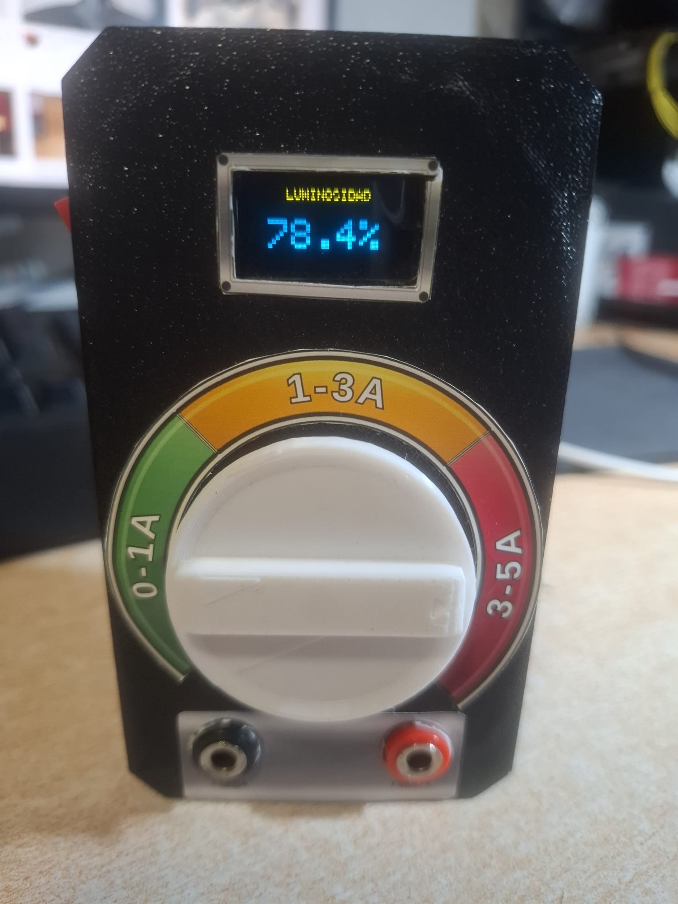

# Laboratorio Final Integrador – Grupo 03

Instrumentación y Medidas Eléctricas – Ingeniería en Mecatrónica, UTEC (2026).

**Integrantes:** Ignacio Martínez y Lucas Elizalde.

## Proyecto

En este laboratorio ampliamos el amperímetro que habíamos realizado en el Laboratorio 1. Incorporamos la medición de temperatura, humedad y luminosidad relativa, además de la corriente.

Utilizamos un Arduino Nano para leer los sensores y un ESP32-C3 para enviar las mediciones por MQTT a la PC. Los datos se guardan en SQLite y se sincronizan con la base MySQL del servidor del laboratorio. Desde la página web podemos consultar el histórico y cambiar los intervalos de muestreo del instrumento.

## Archivos

- `Arduino_Nano` y `ESP32_C3`: códigos de las dos placas.
- `Servidor_Local`: programas de Python y archivo BAT para iniciar los procesos en Windows.
- `Servidor_Web`: archivos de la página y del servidor PHP.
- `Base_de_Datos`: estructuras SQL.
- `Documentacion` y `Evidencias`: informe, fotos y capturas de las pruebas.

[Dashboard del grupo](https://utecnologica.org/estudiantes/imel/g03/) | [Informe](Documentacion/Informe_Final.pdf)

## Notas

La copia no incluye contraseñas reales. Para ejecutarla en otro equipo hay que configurar WiFi, MQTT, la base de datos y las URLs del servidor. Usamos `iniciar_lab3_final.bat` para arrancar los tres programas locales; las dependencias de Python están en `requirements.txt`.

El envío de mediciones quedó en 10 s para las pruebas (600 s según la consigna para operación normal). `receptor_sqlite.py` y los esquemas SQL son reconstrucciones compatibles; falta cotejarlos con los originales de la PC. No se hicieron nuevas pruebas de hardware con esta copia. El informe todavía tiene enlaces por completar. La API no tiene autenticación propia; no usarla en un nuevo despliegue público sin protegerla ni enviar datos de prueba al servidor activo.
